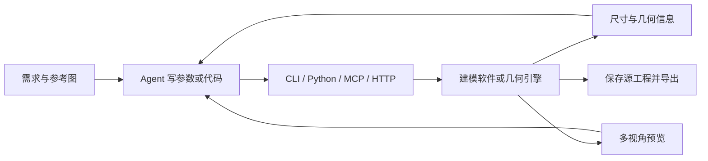

# AI 与 Agent 三维建模技术及连接方式调研

> 调研日期：2026-11-15。本文将“建模”理解为三维建模，覆盖视觉资产、参数化 CAD、网页三维和图生/文生 3D；不讨论数据建模、机器学习训练或数学建模。核查依据为官方文档、官方仓库和桥接项目源码/README。本文完成资料核查与方案设计，未安装建模软件、修改 Agent 配置、调用付费生成接口，也未实测生成质量和端到端成功率。

## 1. 结论与优先选择

**最值得先试的两条路线是：视觉建模用 Blender + Python + MCP；精确零件用 CadQuery 或 build123d + Python 直接执行。** 如果目标是快速获得角色、道具等带纹理资产，可以先调用 Meshy/Tripo API，再交给 Blender 整理。

先确定模型用途，再决定连接方式：

| 目标 | 优先技术 | Agent 如何连接 | 应保留的主要交付物 |
|---|---|---|---|
| 场景、产品展示、动画、程序化视觉模型 | Blender、`bpy`，需要时加 Geometry Nodes | 交互修改用 MCP + Blender 插件；批量生成用 CLI | `.blend`、生成脚本、渲染图；需要时导出 GLB/FBX |
| 外壳、支架、夹具、尺寸明确的打印零件 | CadQuery / build123d | Agent 写 Python，由本地 Python 进程执行；MCP 可后加 | Python 参数与源码、STEP；打印时另导 STL/3MF |
| 希望直接在 CAD 窗口中查看、改草图和特征 | FreeCAD + Python | 社区 MCP + FreeCAD 插件；批处理也可使用 FreeCADCmd | `.FCStd`、脚本、STEP |
| 简单几何、布尔组合、参数化打印小物 | OpenSCAD | Agent 写 `.scad`，调用命令行生成模型 | `.scad`、STL/3MF；不将它作为 STEP 交付的默认路线 |
| 希望接现成的云端参数化 CAD 能力 | Zoo / KCL | 官方 Zoo MCP，或自行接 Zoo API | `.kcl` 项目、按接口支持导出的 CAD 文件 |
| 文生/图生角色、雕塑、游戏道具初稿 | Meshy / Tripo | HTTPS API；也可由支持这些服务的 Blender MCP 代接 | 网格、纹理、生成输入，再保存整理后的 `.blend` |
| 本地或自托管图生 3D | Hunyuan3D 等开放权重模型 | Python 推理，或 HTTP 服务，再封装为工具 | 网格、纹理、输入图、推理配置 |
| 网站中的三维示意、交互展示、代码动画 | Three.js | Agent 修改 JS/TS 项目并运行浏览器预览 | 源码、资源、需要时导出 GLB |

这些是按文档能力作出的工程建议，不是实测排名。Blender、CadQuery、build123d、FreeCAD、Zoo 和 Three.js 的能力分别见 [S1]—[S9]、[S15]。

## 2. 先区分三种模型结构

### 2.1 多边形网格：主要解决外观和渲染

Blender 及多数文生/图生 3D 服务主要面向网格资产。网格由顶点、边、面组成，适合表现轮廓、材质、动画与复杂有机外形。

“网格能继续编辑”不代表它自带设计参数。例如，生成一个带螺丝孔的机壳，不代表文件里存在“孔径 4 mm、孔距 40 mm”的参数或草图约束。Agent 可以后续修改顶点，但要稳定保留设计意图，应另外建立参数、修改器或建模脚本。

### 2.2 参数化实体 / B-rep：主要解决尺寸和工程几何

CadQuery、build123d 基于 Open Cascade 提供参数化 CAD 建模。B-rep 用面、边等表达实体边界，可用于拉伸、旋转、圆角、倒角和布尔运算，适合机械零件。[S3][S4]

这里还有两个不同层次：

- **源码参数化**：改 Python/KCL 中的尺寸，重新生成模型。
- **原生特征历史**：在 FreeCAD/Fusion 等软件里保留草图、拉伸、孔、圆角等可继续操作的特征。

导出 STEP 通常可交换实体几何，但不应承诺它在目标软件中自动恢复原始草图、约束和完整特征树。因此需要参数化修改时，应同时交付源码或原生工程文件。

### 2.3 视觉重建：主要解决“从实物或图片得到三维”

单张图片中没有展示的背面、厚度和内部结构，需要生成模型作出推断，不能据此认定尺寸真实。需要复制真实零件时，应补充已知尺寸、多视图、扫描或测量数据。

NeRF、Gaussian Splatting 可用于外观与场景重建，但不宜直接当作可制造 CAD 实体。若目标是加工或装配，仍需重建实体并检查几何与尺寸。这是模型表示方式的区别，换成 MCP 连接不会消除它。

## 3. Agent 的连接方式怎么选

| 连接方式 | 实际调用链 | 适用情况 | 需要理解的边界 |
|---|---|---|---|
| 本地 CLI / 子进程 | Agent → 写源码 → 启动 Blender/Python/OpenSCAD/FreeCADCmd | 从零生成、批处理、重复构建 | 通常执行完获得文件，不会自动修改用户已打开的另一个软件实例 |
| Python SDK / 库 | Agent 工具函数 → CadQuery/build123d 等库 | 自建应用、参数明确的零件生成 | Agent 仍需具备代码执行环境；模型输出代码本身不等于执行 |
| MCP + 应用内插件 | Agent → MCP server → 插件/RPC/socket → 软件 API | 边聊天边查看、修改现有场景或文档 | 插件负责触达软件；只配置 MCP server 可能还没有真正连通 |
| HTTP API | Agent → 工具函数 → 服务 API → 任务/文件 | 云端生成、远程几何计算、自托管推理 | 要处理任务状态和结果下载；API 付费、格式和能力由服务决定 |
| 桌面 / 浏览器 UI 自动化 | Agent → 点击、键盘、菜单 | 没有合适 API，或少量界面专有操作 | 依赖窗口、焦点、模式和软件版本，复杂连续建模通常应优先找 API |

**MCP 是工具连接层，Python/API 才是执行建模操作的入口。两者可以组合，也可以只用后者。**

MCP 标准传输包括 `stdio` 和 `Streamable HTTP`。本地客户端启动一个 MCP 子进程时，常用 `stdio`；独立运行的 MCP 服务可以采用 Streamable HTTP。Blender 插件内部使用 TCP socket，不代表 Agent 与 MCP server 之间也使用这个 TCP 协议。[S2][S16]

Skill 主要告诉 Agent 建模规范、操作步骤和检查方法；它不会单独赋予软件控制能力。一个 Skill 可以指导 Agent 调 CLI，也可以指导它调用 MCP 工具。

建议采用的最小闭环：



这套结构的核心是让 Agent 既能操作，也能读取结果、查看图像、修正和保存。只有一个“执行代码”工具时，连接可以成功，但闭环还不完整。

## 4. 各技术路线的接入与取舍

### 4.1 Blender + Python + MCP：通用视觉建模的优先试用方案

Blender 官方 Python API 提供数据访问、对象和材质操作、工具执行、UI 扩展等能力。`bpy.data` 可直接读写数据；`bpy.ops` 会受到当前模式、选择与编辑器上下文影响，脚本编写时应区分两者。[S1]

社区项目 **ahujasid/mcp-for-blender** 原名 `blender-mcp`。截至核查时，新安装包名已为 `mcp-for-blender`；README 表示旧命令兼容，但新配置应使用新包名。该项目是第三方集成，不是 Blender 官方 MCP。[S2]

实际连接分为两段：

```text
MCP 客户端 ──stdio──> MCP for Blender 服务
                            │
                      本地 TCP/JSON
                            ↓
                      Blender 插件 ──> bpy
```

项目提供场景读取、Python 执行、多视角查看和素材导入等能力，还可按配置接入 Meshy、Tripo、Hyper3D、Hunyuan3D 等生成服务。生成服务是可选能力，普通 Python 建模不要求购买这些生成服务。[S2]

手动接入示例，**仅展示配置方式，本次未执行安装**：

```powershell
uvx mcp-for-blender install-addon
```

随后在 Blender 中启用 **MCP for Blender** 插件，确认插件的服务已启动；在支持下述 JSON 格式的 MCP 客户端中配置：

```json
{
  "mcpServers": {
    "blender": {
      "command": "uvx",
      "args": ["mcp-for-blender"]
    }
  }
}
```

不同客户端配置文件格式可能不同，应使用其 MCP 配置入口填写相同的命令和参数。Windows 下还要确保客户端进程能够找到 `uvx`。

插件默认连接 `localhost:9876`。若跨机器使用，该项目明确说明插件 socket 没有认证或加密；应保留本地监听，通过 SSH 隧道等方式连接，不能把这个端口当作已认证的云 API。[S2]

如果只是批量生成新文件，官方 CLI 已足够，不必先搭桥接服务：

```powershell
blender --background --python-exit-code 1 --python build_scene.py
```

`build_scene.py` 负责建模、保存 `.blend`、输出预览和所需格式。`--python-exit-code 1` 可让命令行脚本异常通过退出码反映出来。Blender 参数按顺序执行，文件载入与渲染参数的顺序会影响结果。[S5]

**适合**：产品视觉、规则家具与场景、程序化造型、动画和材质灯光。复杂角色拓扑、绑定、权重和精细雕刻仍需要专门处理，不能仅凭“已经连上 MCP”承诺质量。

### 4.2 CadQuery / build123d：精确零件与 CAD-as-code

两者都可以在没有 CAD GUI 的环境中执行 Python，Agent 使用普通文件编辑和命令执行工具即可接入。CadQuery 偏向链式 Workplane API；build123d 提供 Builder 与代数式建模方式。选择时优先考虑已有示例、团队熟悉程度和目标操作，不将 API 风格直接当作模型质量排名。[S3][S4]

推荐调用链：

```text
Agent → model.py → Python + CadQuery/build123d
                     ├─ STEP：交换实体几何
                     ├─ STL/3MF：打印交付
                     └─ 几何摘要与预览：供 Agent 检查
```

例如，下列 CadQuery 示例表达一个 `80 × 50 × 4 mm`、四个 `Ø4 mm` 通孔的安装板；孔中心相对板中心为 `(±30, ±15)`。**这是说明代码，不是本次已运行的实测产物。**

```python
import cadquery as cq

length, width, thickness = 80.0, 50.0, 4.0
hole_diameter = 4.0
holes = [(-30, -15), (-30, 15), (30, -15), (30, 15)]

part = (
    cq.Workplane("XY")
    .box(length, width, thickness)
    .faces(">Z").workplane()
    .pushPoints(holes).hole(hole_diameter)
)

cq.exporters.export(part, "plate.step")
cq.exporters.export(part, "plate.stl")
```

如果要构建面向用户的建模产品，可先把这条执行链封装成一个普通工具函数，输入尺寸、输出文件和检查结果；需要服务化时再增加 HTTP 或 MCP。无需为了首次验证就同时引入所有协议。

**适合**：尺寸驱动、规则结构、批量变体、可审查源码。主要限制是复杂造型的表达成本、几何操作失败及修改后特征选择变化；不能把一次脚本运行成功当成所有参数范围都有效。

### 4.3 FreeCAD + Python + 社区 MCP：需要原生 CAD 文档时

FreeCAD 官方支持 Python 自动化、`FreeCADCmd` / `FreeCAD -c` 等无界面运行方式。外部 Python 嵌入还涉及 FreeCAD 库目录、工作台模块路径和运行环境，不应简单理解为任意 Python 中直接 `import FreeCAD` 就能工作。无界面模式也不支持所有 GUI 操作。[S6]

`neka-nat/freecad-mcp` 是可核查的社区桥接项目，包含两部分：[S7]

1. 在 FreeCAD 内安装插件，并启动 RPC server。
2. MCP 客户端运行 `uvx freecad-mcp`，连接到插件。

其文档描述了建模、执行 Python、读取文档、截图与 FEM 相关工具。本次未验证具体工作台和求解器能否在用户机器运行。

需要保留草图与特征时，脚本应创建实际的 Sketcher/PartDesign 等对象；仅把一个最终实体放进 `.FCStd`，不等于拥有可编辑的完整特征历史。

**适合**：想在开源 CAD 窗口中接着编辑、保留原生工程、处理实体零件的场景。

### 4.4 OpenSCAD：简单参数化打印模型

OpenSCAD 采用代码描述几何，适合简单构件与布尔组合。Agent 生成 `.scad` 并调用 CLI，接入步骤少。例如：

```powershell
openscad -o part.stl part.scad
```

命令行输出能力可从官方源码中的 CLI 参数定义核查；具体可选导出格式应以已安装版本为准。[S14]

需要大量复杂曲面、工程圆角或 STEP 交换时，应优先评估 CadQuery/build123d 或传统 CAD。不要把仅有 STL 网格的交付说成可恢复完整设计参数。

### 4.5 Zoo：现成的官方 CAD MCP 与云端工具

Zoo 官方提供 MCP，文档明确给出 `uvx zoo-mcp` 和 `ZOO_API_TOKEN` 接入方式。仓库另支持设备登录，并支持默认 `stdio` 及可选 Streamable HTTP。[S8][S9]

其推荐流程是让 Agent 在项目目录保存 `main.kcl`，通过 MCP 执行、检查几何，再交付可继续修改的 KCL 项目。MCP 服务本身无单独费用，调用托管服务计入 API 使用。[S8]

**适合**：希望较快接上官方 CAD 工具、接受云服务与 KCL 工作流。它是值得试用的候选，不据厂商“生产可用”宣传认定所有复杂零件都能自动满足制造要求。

### 4.6 已有商业 CAD：沿用其原生 API

| 已用工具 | 可利用的入口 | 推荐连接方式 |
|---|---|---|
| Autodesk Fusion | 官方 Python/C++ 脚本与 Add-in API | 应用内脚本，或 Add-in 承接本地工具请求；需要时外包 MCP |
| Rhino / Grasshopper | RhinoCommon、Rhino.Compute | 桌面内调用 API，或用 Compute 执行远程几何/参数化任务 |
| SOLIDWORKS | 官方 COM 自动化与 Add-in 接口 | Windows 本地服务调用 COM，再向 Agent 暴露工具 |

Fusion 脚本与 Add-in 使用同一套 API，但生命周期不同：脚本运行后结束，Add-in 可以在软件会话期间持续运行。[S12] Rhino 的 `rhino3dm` 偏向几何对象和文件处理，完整远程几何计算由 Rhino.Compute 等提供；不能把前者等同于完整 Rhino 引擎。Compute 的生产部署涉及另外的授权和计费条件。[S13] SOLIDWORKS COM 入口由其官方开发文档说明。[S17]

这些官方 API 的存在，不等于每个软件都自带官方 MCP。采用第三方桥接时，应分别核查桥接实现、目标版本和可调用功能。本次未实测这些商业软件的桥接。

## 5. 文生 / 图生 3D 怎么接

### 5.1 云 API：适合先验证资产效果

Meshy 官方 Text to 3D API 包括 preview 和 refine 等流程，返回任务 ID，再查询状态与模型地址；也提供任务更新流。输出格式包含 GLB、OBJ、FBX、STL 等，具体支持和参数随模型版本变化。[S10]

Tripo 官方 API 文档描述了文字/图片生成、精细化、动画和转换等能力。[S11]

通用工作流是：

```text
Agent 提交文字/参考图
    → 创建生成任务
    → 查询任务直到终态
    → 下载网格与纹理
    → 导入 Blender
    → 检查尺度、方向、拓扑、材质并保存
```

接口连接简单，但后续整理仍是独立工作。至少区分：是否只需要静态展示，是否要变形动画，是否要打印。视觉上漂亮的网格不能据此保证有合适的拓扑、壁厚、内部结构或实际尺寸。

预算应包括 Agent 用量、生成服务、重复生成、网格整理与渲染。网页订阅、API 额度和第三方桥接增值服务也不能默认互通。本文不固化单次价格，正式选择时按目标模型和当期 API 计费核算。

### 5.2 本地模型：适合已有算力或自托管需求

以 **Hunyuan3D-2.1** 作为已核查的具体案例，而不是声称它是最新或最佳模型：官方仓库提供 Python 推理，`api_server.py` 提供图生 3D 的 HTTP `/generate` 等入口，可以被普通 HTTP 工具调用，再按需要封装 MCP。[S18]

仓库 README 声明的显存需求为：形状生成约 10 GB、纹理生成约 21 GB、两者合计约 29 GB。这是项目给定口径，不是本次实测最低需求；低显存模式、实现和分辨率会改变实际资源与速度。依赖还涉及 PyTorch/CUDA 和自定义渲染组件，部署成本高于直接调用云 API。[S18]

该项目采用自定义社区许可，并存在地域等条款；“权重可下载”不能等同于 MIT/Apache 式无限制使用。源码个别文件头与根目录 LICENSE 的命名不完全一致，判断使用范围应以适用版本的完整许可为准，而不是只看文件头。[S18][S19]

## 6. 网页三维与完整建模软件的边界

如果只是产品网页中的旋转展示、三维示意或代码驱动动画，可以让 Agent 直接编写 Three.js。官方 `BufferGeometry` 提供顶点、索引等网格结构，`GLTFExporter` 可以输出 glTF/GLB。[S15]

这种需求不一定要启动 Blender。反过来，Three.js 的场景代码也不自动提供机械 CAD 的草图约束、B-rep 实体和制造特征。需要真实美术资产时，可以在 Blender 制作后导出 GLB，再由 Three.js 展示。

建筑也要区分目标：空间效果图和场景可用 Blender/Rhino；如果要求墙、门、楼层、工程量等 BIM 语义，需要进一步针对 BIM 软件及数据接口调研，不应直接把普通场景网格当作 BIM 交付。

## 7. 推荐如何做第一次验证

### 路线 A：想让 Agent 在软件里边做边展示

从 **Blender + MCP for Blender + Python** 开始。选一个结构简单、比例明确的物体，例如带盖收纳盒或台灯，验证：

1. 能读取当前场景并创建对象。
2. 能从正面、侧面、俯视和透视查看结果。
3. 能按要求修改尺寸、颜色或部件位置。
4. 能保存 `.blend`，导出 GLB，并重新打开检查。

不必在第一步同时接入所有模型生成服务；先确认软件执行与反馈闭环是否顺畅。

### 路线 B：想让 Agent 做零件、外壳和打印构件

从 **CadQuery 或 build123d + Python + CAD 查看器** 开始。用前述安装板验证：外形 `80 × 50 × 4 mm`，四孔 `Ø4 mm`，孔中心 `(±30, ±15)`；随后把孔径改为 `Ø5 mm` 重新生成。

验收应包含尺寸、孔的位置与数量、实体有效性、STEP 重新导入和多视角预览。若要打印，还需根据工艺检查壁厚与配合；仅确认 STL 文件存在不够。

### 路线 C：想快速获得角色、雕塑或游戏道具

从 **Meshy/Tripo API + Blender** 开始，用代表性参考图试验轮廓与纹理，再检查背面、隐藏面和后续编辑成本。需要绑定动画时，应单独验证拓扑和变形质量。

三条路线都应先保留生成脚本/参数与源工程，再导出最终文件。只有导出网格而没有源工程，后续“把孔距改大”“让盖子厚一点”等迭代会更难。

## 8. 已确认与待实测

| 项目 | 本次结果 |
|---|---|
| 官方 API、CLI、模型表示与接口能力 | 已通过文档或源码核查，来源见下表 |
| Blender MCP 更名、插件与服务两段连接 | 已核查当前 README |
| FreeCAD MCP、Zoo MCP 接入方式 | 已核查仓库与官方说明 |
| 本机软件、插件、API key 与网络连通性 | 未测试 |
| 建模成功率、实际效果、延迟和总成本 | 未测量；需要用目标物体试做 |
| 本文安装命令、配置和建模示例 | 作为说明提供，未执行 |

## 资料来源

以下资料均于 2026-11-15 访问；官网与 `main` 分支会持续变化，安装前应固定实际使用的版本。

- **[S1] Blender 官方 Python API Quickstart**：数据访问、脚本执行、上下文与 operators。<https://docs.blender.org/api/current/info_quickstart.html>
- **[S2] MCP for Blender 社区项目**：更名、安装、功能、插件 TCP 协议与远程连接边界。<https://github.com/ahujasid/mcp-for-blender>；本次通过旧路径原始 README 读取，内容已更新为新项目：<https://raw.githubusercontent.com/ahujasid/blender-mcp/main/README.md>
- **[S3] CadQuery 官方 Introduction**：Python 参数化建模、Open Cascade、无 GUI 使用与 STEP 等输出。<https://cadquery.readthedocs.io/en/latest/intro.html>
- **[S4] build123d 官方文档**：Python/B-rep、Open Cascade、Builder/代数建模与应用。<https://build123d.readthedocs.io/en/latest/>
- **[S5] Blender 官方 Command Line Arguments**：后台执行、Python 脚本、异常退出码与参数顺序。<https://docs.blender.org/manual/en/latest/advanced/command_line/arguments.html>
- **[S6] FreeCAD 官方 Headless FreeCAD**：控制台、外部 Python 嵌入、工作台路径与无界面执行。<https://wiki.freecad.org/Headless_FreeCAD>
- **[S7] neka-nat/freecad-mcp 社区项目**：插件与 MCP server、RPC 启动与文档入口。<https://github.com/neka-nat/freecad-mcp>
- **[S8] Zoo 官方 MCP 文档**：KCL 项目、接入、API token 与收费口径。<https://zoo.dev/docs/developer-tools/mcp>
- **[S9] Zoo 官方 MCP 仓库**：登录、stdio/Streamable HTTP 和持久建模会话。<https://github.com/KittyCAD/zoo-mcp>
- **[S10] Meshy 官方 Text to 3D API**：异步任务、preview/refine、模型文件和任务状态。<https://docs.meshy.ai/en/api/text-to-3d>
- **[S11] Tripo 官方 API 文档**：文字/图片生成、精细化、动画与转换；本次通过搜索读取页面正文。<https://dev.platform.tripo3d.ai/docs/>
- **[S12] Autodesk Fusion 官方 Scripts and Add-Ins 文档**：API 入口与运行生命周期；本次通过搜索读取页面正文。<https://help.autodesk.com/cloudhelp/ENU/Fusion-360-API/files/WritingDebugging_UM.htm>
- **[S13] Rhino 官方 Compute 文档**：Python 客户端、几何处理与生产部署授权。Python 指南的旧版环境示例不作为当前安装版本建议。<https://developer.rhino3d.com/en/guides/compute/compute-python-getting-started/>；<https://developer.rhino3d.com/en/guides/compute/deploy-to-iis/>
- **[S14] OpenSCAD 官方源码**：命令行参数与输出处理；Wikibooks 命令行页本次返回 403，未将其算作已读取证据。<https://github.com/openscad/openscad/blob/master/src/openscad.cc>
- **[S15] Three.js 官方文档**：网格结构与 glTF/GLB 导出。<https://threejs.org/docs/pages/BufferGeometry.html>；<https://threejs.org/docs/pages/GLTFExporter.html>
- **[S16] MCP 官方 Transports 规范（2025-11-25）**：stdio、Streamable HTTP 与 JSON-RPC。引用明确版本，不据此断言它始终是最新规范。<https://modelcontextprotocol.io/specification/2025-11-25/basic/transports>
- **[S17] SOLIDWORKS 官方 COM Add-in 文档**：COM 自动化与插件接口；本次通过搜索读取正文，用于说明入口，不据旧版页面确认新版本兼容性。<https://help.solidworks.com/2022/English/api/sldworksapiprogguide/Overview/Using_SolidWorks_CPlusPlus_NET_Add-In_Wizard_to_Create.htm>
- **[S18] Tencent Hunyuan3D-2.1 官方仓库**：Python 推理、依赖与显存声明。<https://github.com/Tencent-Hunyuan/Hunyuan3D-2.1>；HTTP 接口：<https://github.com/Tencent-Hunyuan/Hunyuan3D-2.1/blob/main/api_server.py>
- **[S19] Hunyuan3D-2.1 LICENSE**：自定义社区许可及地域范围。<https://github.com/Tencent-Hunyuan/Hunyuan3D-2.1/blob/main/LICENSE>
